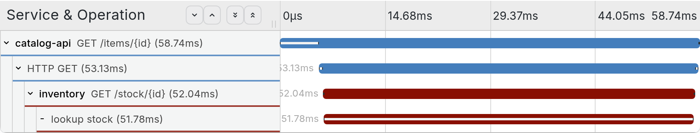
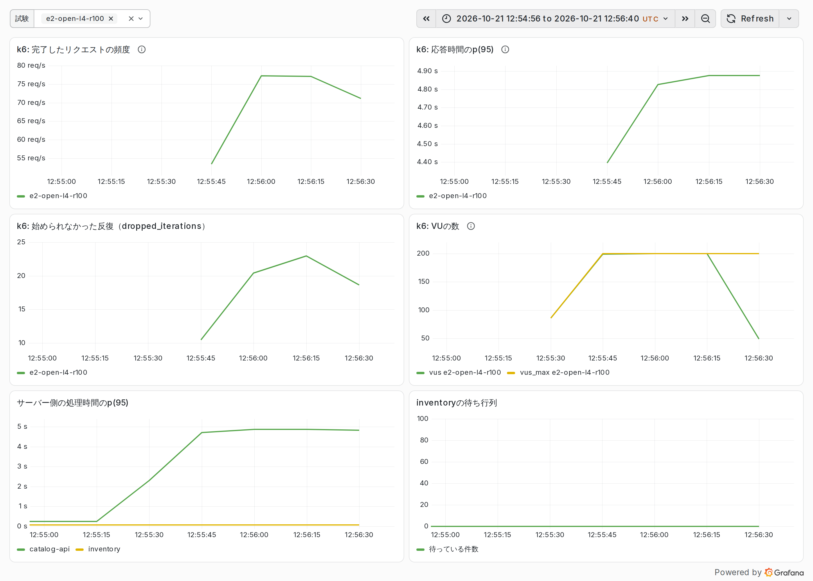

ここまで合否の判定に使った応答時間とエラー率は、[k6](https://grafana.com/docs/k6/v2.3.x/)の側から見たものでした。k6が測るのは、リクエストを送ってから応答を受け取るまでの時間です。その時間のうち、`catalog-api`や`inventory`での処理時間は、k6には見えません。修正前のバージョンで約2.6秒かかった処理の内訳は、まだ調べていません。2章の構成から疑った同時実行数の制限が、実際にどれだけ待ち時間を生んでいたかを確かめます。

アプリケーション内部での動作を確かめるには、アプリケーション自身が出すテレメトリーが必要です。`catalog-api`と`inventory`のテレメトリーと、k6のテストのメトリクスを1か所に集めてみましょう。

## アプリケーションの計装

OpenTelemetryではテレメトリーをトレース、メトリクス、ログの3種類の**シグナル**に分けます。**トレース**は、1件のリクエストの処理を、区間を表す**スパン**の木で表したものです。スパンは名前と開始と終了の時刻を持ち、親のスパンの中に子のスパンが入ります。`catalog-api`のスパンの子として`inventory`のスパンを記録するには、HTTPのヘッダーでトレースの識別子を受け渡します。この受け渡しを**伝搬**（propagation）と呼びます[^propagation]。

サンプルの2つのサービスは、SDKで3つのシグナルを記録し、テレメトリーを送受信するプロトコル**OTLP**で外部へ送ります[^otlp]。送り先とサービス名は、環境変数で指定します[^sdk-init]。

[^otlp]: OTLPはOpenTelemetry Protocolの略です。サンプルでは、3つのシグナルともHTTPで送るOTLP/HTTPを使います（[OTLP仕様](https://opentelemetry.io/ja/docs/specs/otlp/)）。

HTTPの計装には、GoのHTTPサーバーとクライアントにスパンやメトリクスの記録を組み込むライブラリ[otelhttp](https://pkg.go.dev/go.opentelemetry.io/contrib/instrumentation/net/http/otelhttp@v0.72.0)を使います。サーバー側には受信したリクエストを処理する区間、クライアント側には`inventory`を呼び出す区間の計装を組み込みます[^http-instrumentation]。

このHTTPの計装で、1件のリクエストに対して3つのスパンが記録されます。`catalog-api`のサーバースパン`GET /items/{id}`、その子で`inventory`を呼ぶクライアントスパン`HTTP GET`、さらにその子で`inventory`のサーバースパン`GET /stock/{id}`です。`inventory`では、これらに加えて在庫を調べる処理を`lookup stock`という子のスパンで囲みました。

負荷が軽いときのトレースでは、4つのスパンが入れ子になり、子のスパンは親のスパンの区間の中に収まります（図1）。


*図1: 修正前のバージョンに閉じたモデルの1VUで負荷をかけたテストのトレースを1件、GrafanaのExploreで表示した画面。左の列の字下げがスパンの親子関係、右の列の横棒が各スパンの区間を表す*

メトリクスは、otelhttpがサーバーとクライアントの処理時間の分布を**ヒストグラム**として記録します。ヒストグラムは、値を範囲ごとに分け、それぞれの範囲に入る件数を数えたものです。この分布から、サービスごとの処理時間を比べます[^http-metrics]。

`inventory`では、処理中の件数、待ち行列で待っている件数、あふれて断った件数も記録します。処理時間とあわせて見ることで、待ち行列が詰まったかを確かめられます[^queue-metrics]。

ログには、そのとき実行中のスパンのトレースIDとスパンIDを付けます。同じリクエストの処理中に起きた出来事を、トレースからログへ移って調べるためです[^log-context]。

## k6のOpenTelemetry出力

k6のOpenTelemetry出力は、テストのメトリクスをOTLPで送る機能です[^otelout]。サンプルでは、アプリケーションと同じ収集先へ送ります[^k6-config]。

[^otelout]: [OpenTelemetry output](https://grafana.com/docs/k6/v2.3.x/results-output/real-time/opentelemetry/)。k6 v2.3.0のソースでは、この出力は`opentelemetry`と`experimental-opentelemetry`の2つの名前で登録されています。

この出力が送るのはメトリクスだけです[^output-check]。トレースは、k6の出力ではなく、アプリケーション側の計装と伝搬で作られます。

[^output-check]: k6のテストのあと、Tempoに記録されたサービスは`catalog-api`と`inventory`の2つだけで、`service.name`が`k6`のトレースは0件でした。Lokiに入ったログも、同じ2つのサービスのものしかありません。

k6のメトリクスには、テストごとに`testid`タグを付けます[^testid]。このタグはメトリクスの保存先であるMimirではラベルになり、テストを指定して検索できます。メトリクス名は保存先の形式に変わりますが、応答時間やリクエスト数を引き続き調べられます[^naming]。

[^naming]: Mimirに届いたk6のメトリクス名は、`http_req_duration_milliseconds`、`http_reqs_total`、`dropped_iterations_total`などです。k6 v2.3.0のOpenTelemetry出力は、k6自身のメトリクス名（`http_req_duration`のようにアンダースコアで区切る）をそのまま送り、時間のメトリクスには単位`ms`を付けます（[`internal/output/opentelemetry/output.go`](https://github.com/grafana/k6/blob/v2.3.0/internal/output/opentelemetry/output.go)の`normalizeUnit`）。アプリケーションのメトリクスは、OpenTelemetryのセマンティック規約（メトリクスや属性の名前と単位を定めた規約）の名前で、`http.server.request.duration`のようにドットで区切り、単位は`s`です。MimirはOTLPで受けたメトリクス名をPrometheusの形式に変換して保存します。今回の構成では`otel_metric_suffixes_enabled: true`（`-distributor.otel-metric-suffixes-enabled`）を設定し、ドットをアンダースコアに置き換えたうえで、単位（`_seconds`、`_milliseconds`）とカウンターの`_total`を末尾に付けました。変換の方式そのものを変える場合は`-distributor.otel-translation-strategy`で指定します（[Mimir 3.2の設定のリファレンス](https://grafana.com/docs/mimir/v3.2.x/configure/configuration-parameters/)）。その結果、Mimirの中では`http_req_duration_milliseconds`と`http_server_request_duration_seconds`のように、どちらもアンダースコアで区切った名前になります。

一方、アプリケーションのメトリクスには`testid`のラベルがありません。`catalog-api`は、どのテストから届いたリクエストなのかを知らないからです[^app-testid]。

[^app-testid]: アプリケーションのメトリクスに`testid`を付けるには、テスト対象のサービスがリクエストごとにテストの識別子を受け取る必要があります。たとえば、k6が[W3C Baggage](https://www.w3.org/TR/baggage/)（リクエストに添えて伝搬するキーと値の組）の`baggage`ヘッダーで`testid`を送り、サービスのハンドラーがその値をotelhttpの[`Labeler`](https://pkg.go.dev/go.opentelemetry.io/contrib/instrumentation/net/http/otelhttp@v0.72.0#Labeler)でメトリクスの属性に加える方法があります。サンプルの伝搬の設定はBaggageも受け渡すので、`catalog-api`から`inventory`への呼び出しにも同じ値が届きます。ただし、テストのためにサービスのコードを変えることになり、`testid`の値ごとにメトリクスの時系列も増えます。本書ではこの方法を使わず、テストの時間範囲で対応づけます。

## 収集と保存

`catalog-api`と`inventory`のテレメトリー、およびk6のメトリクスは、いったんコレクターの[Grafana Alloy](https://grafana.com/docs/alloy/v1.20/)に集めます。Alloyはテレメトリーを受信し、シグナルごとに保存先へ転送します[^alloy]。

[^alloy]: AlloyはGrafana Labsが開発するテレメトリーのコレクターで、OpenTelemetry Collectorのコンポーネントを組み合わせて設定を書けます。サンプルの設定は、OTLPを受けてシグナルごとに保存先へ振り分けるだけです。設定の全体は、サンプルのリポジトリの[`config/config.alloy`](https://github.com/ymotongpoo/k6-otel-perf-review/blob/f86b6ed88a1dbb34050897a984f9997e67f78d4a/config/config.alloy)にあります。OTLPのレシーバー（gRPCの4317番とHTTPの4318番）、バッチ処理、3つの保存先への送信からなります。

    ```alloy
    otelcol.processor.batch "default" {
      output {
        metrics = [otelcol.exporter.otlphttp.mimir.input]
        traces  = [otelcol.exporter.otlp.tempo.input]
        logs    = [otelcol.exporter.otlphttp.loki.input]
      }
    }
    ```

メトリクスは[Grafana Mimir](https://grafana.com/docs/mimir/v3.2.x/)、トレースは[Grafana Tempo](https://grafana.com/docs/tempo/v3.1.x/)、ログは[Grafana Loki](https://grafana.com/docs/loki/v3.7.x/)に入れ、[Grafana](https://grafana.com/docs/grafana/v13.2/)を可視化と検索の画面として使います[^storage-layout]。

[^storage-layout]: 3つの保存先はいずれもOTLPを直接受け付けるので、Alloyの側での形式の変換は不要です。サンプルでは、Alloy、Mimir、Tempo、Loki、Grafanaを、それぞれのコンテナイメージから別々のコンテナとして起動しています（[`compose.yaml`](https://github.com/ymotongpoo/k6-otel-perf-review/blob/f86b6ed88a1dbb34050897a984f9997e67f78d4a/compose.yaml)）。各保存先は単一のプロセスで動かし、データはローカルのファイルシステムに置いています。これらを1つのコンテナにまとめた[grafana/otel-lgtm](https://github.com/grafana/docker-otel-lgtm/tree/v0.37.0)は使っていません。otel-lgtm v0.37.0は、コレクターにOpenTelemetry Collector、メトリクスの保存先にPrometheusを使います。

保存したデータは、サービス名を指定して検索できます。ログはトレースIDでも絞り込めるので、特定のリクエストに対応する記録を探せます[^resource-labels]。

Grafanaでは、Tempoのデータソースにトレースからログへ移る設定を入れました。トレースの画面でスパンを選ぶと、そのスパンのサービス名とトレースIDでLokiを検索します[^trace-to-logs]。

これで、k6のメトリクス、アプリケーションのメトリクス、トレース、ログの4種類を同じGrafanaから調べられます。サンプルのリポジトリには、k6とアプリケーションのメトリクスを並べたダッシュボードも入れてあります。図2は、3章の修正前のバージョンに毎秒100件をかけたテストを選んだ画面です。


*図2: 修正前のバージョンに毎秒100件をかけたテストを、サンプルのダッシュボードでGrafanaに表示した画面。上の2段がk6のメトリクス、下の段がアプリケーションのメトリクス*

ダッシュボードでは、`catalog-api`の処理時間が大きく伸び、`inventory`の処理時間は短いままです。ただし、表示されたp(95)はk6の要約の約2.6秒より大きくなっています。集計方法によるこの差は、次章で説明します。

同じGrafanaから調べられても、これらのデータのつながり方は同じではありません。トレースとログはトレースIDでつながり、k6のメトリクスとアプリケーションのメトリクスをつなぐものは時刻だけです。図2の上の2段は`testid`でテストを選べますが、下の段は同じ時間範囲を表示しているにすぎません。

[^propagation]: ヘッダーの形式は[W3C Trace Context](https://www.w3.org/TR/trace-context/)の`traceparent`です。クライアント側のHTTPの計装がリクエストに付けます。

[^sdk-init]: 2つのサービスは同じ初期化コードを使います。送り先とサービス名は、標準の環境変数`OTEL_EXPORTER_OTLP_ENDPOINT`と`OTEL_SERVICE_NAME`で渡します。抜粋の最後の`logger`は簡略化したもので、サンプルのコードでは同じログを標準出力にも書いています。

    ```go
    tp := sdktrace.NewTracerProvider(sdktrace.WithResource(res), sdktrace.WithBatcher(te))
    otel.SetTracerProvider(tp)
    otel.SetTextMapPropagator(propagation.NewCompositeTextMapPropagator(
        propagation.TraceContext{}, propagation.Baggage{}))

    mp := sdkmetric.NewMeterProvider(sdkmetric.WithResource(res),
        sdkmetric.WithReader(sdkmetric.NewPeriodicReader(me, sdkmetric.WithInterval(5*time.Second))))
    otel.SetMeterProvider(mp)

    lp := sdklog.NewLoggerProvider(sdklog.WithResource(res), sdklog.WithProcessor(sdklog.NewBatchProcessor(le)))
    otel.SetLoggerProvider(lp)
    logger := slog.New(otelslog.NewHandler(scope, otelslog.WithLoggerProvider(lp)))
    ```

[^http-instrumentation]: サーバー側はハンドラーを`otelhttp.NewHandler`で包み、クライアント側は`http.Client`のトランスポートを`otelhttp.NewTransport`で包みます。

    ```go
    client := &http.Client{
        Transport: otelhttp.NewTransport(&http.Transport{MaxIdleConnsPerHost: 256}),
        Timeout:   2 * time.Second,
    }
    srv := &http.Server{Addr: ":8080", Handler: otelhttp.NewHandler(mux, "catalog")}
    ```

[^http-metrics]: 処理時間のメトリクス名は、サーバー側が`http.server.request.duration`、クライアント側が`http.client.request.duration`です。

[^queue-metrics]: 処理中のリクエストの数を表す`http.server.active_requests`は、otelhttp v0.72.0の記録の対象外です。`inventory`では、同じ名前のメトリクスを、加算と減算で現在の件数を表す増減するカウンター（UpDownCounter）として自分で記録しました。あわせて、待ち行列で待っている件数（`inventory.queue.waiting`、増減するカウンター）と、あふれて断った件数の累計（`inventory.queue.rejected`、増えるだけのカウンター）も記録しています。

[^log-context]: [Go](https://go.dev/)の標準の`log/slog`を[otelslog](https://pkg.go.dev/go.opentelemetry.io/contrib/bridges/otelslog@v0.21.0)でOpenTelemetryのログに変換して送ります。`logger.WarnContext(ctx, ...)`のようにコンテキストを渡して書くと、そのとき実行中のスパンのトレースIDとスパンIDが付きます。

[^k6-config]: `k6 run -o opentelemetry`で有効にし、送り先は`K6_OTEL_`で始まる環境変数で設定します。プロトコルのデフォルトはgRPCですが、サンプルではAlloyのHTTPの受信エンドポイントに送るので、HTTPに変えました。

    ```yaml
    environment:
      K6_OTEL_EXPORTER_PROTOCOL: http/protobuf
      K6_OTEL_HTTP_EXPORTER_ENDPOINT: alloy:4318
      K6_OTEL_HTTP_EXPORTER_INSECURE: "true"
      K6_OTEL_SERVICE_NAME: k6
    ```

[^testid]: テストを識別する`testid`は、k6のタグとして付けます。このタグはOpenTelemetryの属性に変換され、Mimirではラベルになります。

    ```javascript
    const label = __ENV.LABEL || model;

    export const options = {
      tags: { testid: label },
    };
    ```

[^resource-labels]: テレメトリーの発生元を表す[リソース属性](https://opentelemetry.io/ja/docs/concepts/resources/)は、保存先によって扱いが違います。Mimirでは、`service.name`が`job`ラベルになります。選ぶ条件は、`catalog-api`のメトリクスなら`job="catalog-api"`、k6のメトリクスなら`job="k6"`です。Lokiでは、`service.name`が`service_name`というラベルになり、ログに付いたトレースIDとスパンIDは構造化メタデータの`trace_id`と`span_id`に入ります。

[^trace-to-logs]: Tempoのデータソースに設定した、トレースからログへ移るための設定です。

    ```yaml
    - name: Tempo
      type: tempo
      uid: tempo
      url: http://tempo:3200
      jsonData:
        tracesToLogsV2:
          datasourceUid: loki
          spanStartTimeShift: -1m
          spanEndTimeShift: 1m
          filterByTraceID: true
          customQuery: true
          query: '{service_name="$${__span.tags["service.name"]}"} | trace_id="$${__span.traceId}"'
    ```
