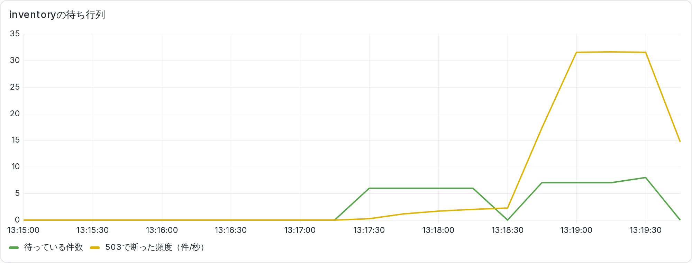
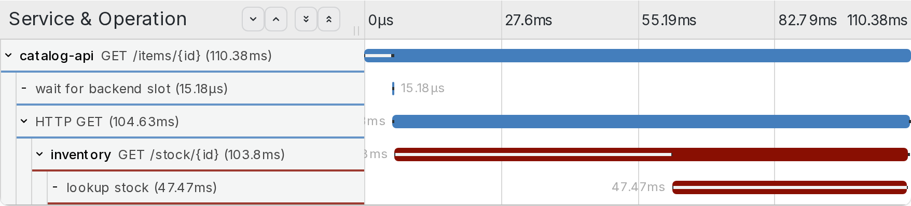

7章で修正前の遅さが同時実行数の制限による待ちだと確かめられましたが、上限を16に上げたバージョンは2章の運用担当のテストに合格しませんでした。なぜ合格しないのかを、待機区間のスパンを入れたまま確かめます。

## 頻度を変えて比べる

同じ開いたモデルで、修正前と修正後のバージョンに毎秒60件から150件までの負荷をかけました。合否の基準には、4章で足した`dropped_iterations`の閾値も入れています。

| 指定した頻度 | 修正前 完了の頻度 | p(95) | エラー率 | 修正後 完了の頻度 | p(95) | エラー率 |
| --- | --- | --- | --- | --- | --- | --- |
| 60件/秒 | 60.0件/秒 | 67.6ms | 0% | 59.9件/秒 | 67.4ms | 0% |
| 90件/秒 | 77.1件/秒 | 2,618ms | 0% | 89.9件/秒 | 67.3ms | 0% |
| 120件/秒 | 77.1件/秒 | 2,623ms | 0% | 119.8件/秒 | 126.7ms | 1.65% |
| 150件/秒 | 77.0件/秒 | 2,629ms | 0% | 149.7件/秒 | 133.3ms | 20.92% |

毎秒60件では、どちらのバージョンも上限に届かないので差はありません。毎秒90件では、修正前のバージョンが上限の毎秒77件で止まり、修正後のバージョンは負荷が軽いときと同じ応答時間を保ちました。毎秒90件のテストでは、修正の効果がはっきり出ました。毎秒120件になると、修正後のバージョンも応答時間が伸び始め、エラーが出ます。

## 修正後の待ち時間の発生箇所

修正後のバージョンで伸びた時間がどこで使われたのかを、トレースから集計しました。7章で足した空きを待つスパンと、6章と同じ方法で求めた`inventory`の中の待ち時間（サーバースパンと`lookup stock`の差）を比べます。ここでも、`inventory`が受け付け、在庫処理まで進んだリクエストだけを集計します[^accepted]。

[^accepted]: 6章と同じく、どの行も`inventory`が受け付けたリクエストだけを集計しています。300件のうち、毎秒120件では294件、毎秒150件では232件がその集合で、ほかの条件では300件すべてです。

| 条件 | `catalog-api`で空きを待つ時間 中央値 | `inventory`の中で待つ時間 中央値 | p(95) |
| --- | --- | --- | --- |
| 修正前、毎秒90件 | 2,473.5ms | 0.2ms | 0.3ms |
| 修正後、毎秒90件 | 0.0ms | 0.2ms | 0.3ms |
| 修正後、毎秒120件 | 0.0ms | 51.3ms | 66.2ms |
| 修正後、毎秒150件 | 0.0ms | 58.9ms | 73.0ms |

上限を16にすると、`catalog-api`で空きを待つ時間はどの頻度でもほぼ0になりました。そのかわり、毎秒120件では`inventory`の中で約50ms待つようになっています。これは、`catalog-api`が16件まで同時に送るようになり、6件しか同時に処理できない`inventory`の前に列ができたためです。列が上限の8件を超えた分は503で断られ、`catalog-api`からは502として返りました。毎秒120件のときのエラー率1.65%は、すべてこの502です。

*図1: 修正後のバージョンに毎秒60件から150件まで順にかけた時間帯の、`inventory`の待ち行列をGrafanaで表示した画面*

修正後のバージョンに毎秒120件をかけたときのトレースでも、待ち時間が`inventory`の中にあることを確認できます。

*図2: 修正後のバージョンに毎秒120件をかけたテストのトレースを1件、GrafanaのExploreで表示した画面*

`catalog-api`の空きを待つスパンはごく短く、`inventory`のサーバースパンには、子スパンの`lookup stock`で説明されない時間があります。`lookup stock`が始まるまでの約56msが、処理枠の空きを待っていた時間です。

ただし、毎秒90件では`inventory`の中の待ちはほとんど増えていません。サンプルで言えるのは、「制限を緩めると、必ず呼び出し先が詰まる」ことではなく、「`inventory`の上限の毎秒120件に近づくと、待ちが`inventory`へ移る」ことです。

## 繰り返して比べる

1回のテストの結果だけで判定すると、たまたま基準の境目をまたいだ値を拾うおそれがあります。毎秒90件と120件について、修正前と修正後を交互に5回ずつ流しました。

| 指定した頻度 | バージョン | p(95)の範囲 | エラー率の範囲 | 合格した回数 |
| --- | --- | --- | --- | --- |
| 90件/秒 | 修正前 | 2,592.5〜2,613.7ms | 0% | 0/5 |
| 90件/秒 | 修正後 | 67.1〜67.3ms | 0% | 5/5 |
| 120件/秒 | 修正前 | 2,617.8〜2,623.6ms | 0% | 0/5 |
| 120件/秒 | 修正後 | 124.9〜126.9ms | 1.26〜1.79% | 0/5 |

判定は5回とも同じでした。修正後のバージョンは、毎秒90件なら毎回合格し、毎秒120件では毎回エラー率が1%を超えます[^runs]。

[^runs]: 待機区間のスパンを外した回なども含めると、修正後のバージョンに毎秒120件をかけたテストは、記録からの再実行を除いて11回ありました。エラー率は1.26%から1.79%の範囲でした。

サンプルのばらつきがここまで小さいのは、処理時間を待機で作っているからです。CPUやディスク、ネットワークを実際に使う処理では、同じ条件でも回ごとの差はもっと大きくなります。範囲が基準の境目をまたぐなら、1回の合格は合格の根拠として不十分です。その場合は、合格と不合格の両方が出たことを、範囲と一緒に記録します。

## 改善しなかった結果

修正後のバージョンは、毎秒90件では合格し、運用担当が見積もった毎秒120件では合格しませんでした。修正は`catalog-api`の待ちを取り除き、処理能力の制約を毎秒約77件の`catalog-api`から毎秒約120件の`inventory`へ移しました。毎秒120件で合格しないのは、そこから先の上限が`inventory`の処理能力で決まっているからです。

この結果からは、毎秒120件に耐えるために次に変えるべきものが`catalog-api`ではないことも分かります。試しに上限を64まで上げても、毎秒120件での結果は16のときとほとんど変わりませんでした[^limit64]。`inventory`が同時に処理できる件数は6件のままだからです。次に変えるのは`inventory`の処理能力か、`inventory`を呼ぶ回数で、多くの場合は別のチームの判断になります。

開発担当の10VUのテストでは、`catalog-api`に同時に届くリクエストが最大10件に限られるため、`inventory`の待ち行列があふれる状態を再現できません。`inventory`の処理枠6件を超えた分が並んでも列は最大4件にとどまり、8件の上限を超えて503が返る状態（15件以上の同時到達）にならないからです[^closed-wait]。

[^limit64]: 上限を64にしたとき、毎秒120件でのエラー率は1.35%、p(95)は125.4msでした。

[^closed-wait]: 2章の開発担当のテストで、修正後のバージョンのp(95)が102.5msと負荷の軽いときより伸びていたのは、この最大4件の列で待った分です。トレースでは`inventory`の中で待つ時間が中央値26.8msありました。
