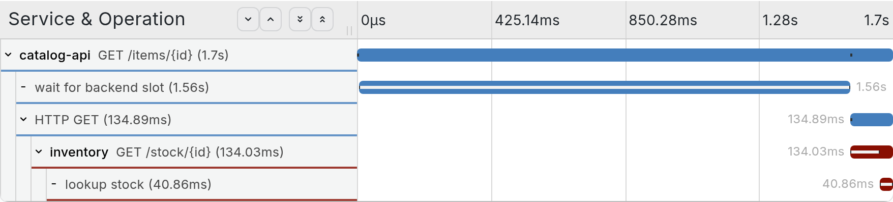
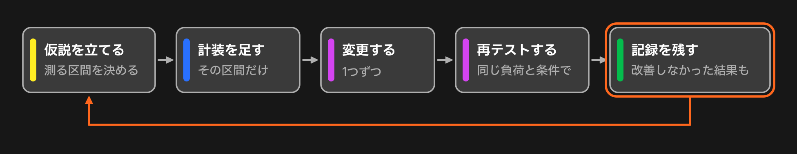

3章で、修正後のバージョンに毎秒150件をかけ、エラー率21.2%で不合格になったテストを示しました。このテストの記録に残っていた設定は、`API_CONCURRENCY=16 MODEL=open RATE=150 DURATION=60s`の1行だけでした。この1行を渡された次の担当者は、同じテストをやり直せるでしょうか。

## 記録に残らなかった設定

私は、サンプルを作る途中で`inventory`の待ち行列の上限を32から8に変えていました。Composeの設定ファイルのデフォルト値を書き換えただけなので、テストのコマンドにも記録にも残っていませんでした。

次の担当者の手元の設定ファイルが、書き換える前の32のままだったとしましょう。同じ1行の設定でテストを流し直すと、結果は次のようになりました。

| テスト | 完了の頻度 | p(95) | エラー率 | 判定 |
| --- | --- | --- | --- | --- |
| 記録したテスト（待ち行列8） | 149.7件/秒 | 133.8ms | 21.2% | 不合格 |
| 次の担当者の再実行（待ち行列32） | 118.0件/秒 | 1,711.7ms | 0% | 不合格 |

どちらも不合格ですが、理由はまったく別です。記録したテストでは、`inventory`の待ち行列があふれて503を返していました。再実行では、`catalog-api`から同時に送れるのは16件なので、`inventory`の処理枠6件を超えても待ち行列32件には収まります。`inventory`が断らずに待たせる間、`catalog-api`の16件の枠も埋まるため、後続のリクエストは`catalog-api`で空きを待つようになり、応答時間のp(95)が1.7秒まで伸びました。同じ条件に7章の待機区間のスパンを入れて流し直すと、伸びた時間の内訳をトレースで確かめられます（図1）[^queue32-wait]。


*図1: `inventory`の待ち行列を32にした再実行と同じ条件に、7章の待機区間のスパンを入れて流し直したテストのトレースを1件、GrafanaのExploreで表示した画面*

[^queue32-wait]: スパンを入れる前の再実行でも、トレース300件の中央値でサーバースパン1,678.1msのうち約1,541msが`catalog-api`側の時間でした。スパンを入れて流し直したテストでも、完了の頻度は毎秒118.0件、p(95)は1,711.6ms、エラー率は0%で、表の再実行と変わりませんでした。

図1のトレースでは、サーバースパンの1.7秒のうち1.56秒を`catalog-api`の空きを待つスパンが占め、`inventory`の中でも`lookup stock`が始まるまでに約93ms待っています。再実行の結果を見た担当者は、修正の効果が出ていないと考えて`catalog-api`を調べ始めるでしょう。記録にない1つの設定のせいで、調べる場所が変わります。

## 記録に残すべきもの

この失敗のあと、テストを流すスクリプトを書き換え、4章で決めたk6のメトリクスやCPU使用率に加えて、テストの実行環境と実際の設定もひとまとめに記録するようにしました[^record-excerpt][^record-image]。

[^record-excerpt]: 記録はJSONの1行で、ここでは一部のキーや長いダイジェストを省略し、小数を丸めて整形しています。`api`が`catalog-api`、`backend`が`inventory`を表します。

    ```json
    {
      "label": "ops-r120-l16",
      "start": "2026-10-21T14:00:01Z",
      "end": "2026-10-21T14:01:03Z",
      "args": "API_CONCURRENCY=16 MODEL=open RATE=120 DURATION=60s CHECK_DROPPED=true",
      "k6_exit": 99,
      "config": {
        "api": {
          "env": { "INSTRUMENT_WAIT": "false", "API_CONCURRENCY": "16", "API_LOCAL_MS": "5" },
          "cpus": 1.0,
          "image": "sha256:632b9d416402..."
        },
        "backend": {
          "env": { "BACKEND_JITTER_MS": "10", "BACKEND_QUEUE": "8", "BACKEND_CAPACITY": "6", "BACKEND_SERVICE_MS": "50" },
          "cpus": 1.0,
          "image": "sha256:5511a8fc6858..."
        },
        "k6_image": "grafana/k6:2.3.0@sha256:9c2dee7f8ed74d317e4027c06a10f169b625638189de8d4555d0b3486a5aeb34",
        "k6_cpus": 1.0,
        "script_sha256": "0462f27de17ea92380669b062497f2d39333ca6d929a43fdb613145bfbc5a346"
      },
      "cpu_pct": { "api": 22.2, "backend": 14.3, "k6-run": 19.3 },
      "reqs": { "count": 7200, "rate": 119.8 },
      "iterations": { "count": 7200, "rate": 119.8 },
      "dropped": { "count": 0, "rate": 0 },
      "p95_ms": 125.6,
      "failed_rate": 0.0153,
      "vus_max": { "value": 50, "min": 50, "max": 50 },
      "vus": { "value": 12, "min": 8, "max": 15 }
    }
    ```

[^record-image]: 記録の仕組みを変えた直後は、記録を読み返して[k6](https://grafana.com/docs/k6/v2.3.x/)のイメージ欄が空だったことに気づきました。k6のサービスはComposeの別のプロファイルに入れてあり、イメージの一覧を取り出すコマンドがそのプロファイルを読んでいなかったためです。

新たに残したのは、実行中のコンテナから読み取ったサービスの環境変数とCPUの割り当て、サービスとk6のイメージです。閾値やタイムアウトの変更を検知するためテストスクリプトのハッシュを残し、5章で見たようにアプリケーションのメトリクスを時間範囲で対応づけるため開始と終了の時刻も記録します。さらにこの記録とは別に、6章で使った[PromQL](https://prometheus.io/docs/prometheus/latest/querying/basics/)、[TraceQL](https://grafana.com/docs/tempo/v3.1.x/traceql/)、[Loki](https://grafana.com/docs/loki/v3.7.x/)のクエリとトレースの集計スクリプトも残し、次の担当者が数値を出し直せるようにします。全項目の一覧は章末のチェックリストにまとめました。

## 記録からやり直す

記録が足りているかは、記録を使ってやり直してみれば分かります。サンプルで用意したのは、記録の1行を読んでテストを流し直すスクリプトです[^replay]。負荷の条件と、各サービスやk6の実際の設定を、記録から戻します。

記録から戻せないのは、コードそのものです。テストスクリプトやテスト対象のサービスのコードが記録した時点と違えば、同じ設定で流しても別のテストになります。そこでこのスクリプトは、コードを戻す代わりに、再実行で記録したスクリプトのハッシュ、2つのサービスのイメージ、k6のイメージ、CPUの割り当てを元の記録と比べ、1つでも違えば警告します。

[^pin-code]: サンプルは、テストスクリプトとテスト対象の2つのサービスを1つのリポジトリに置いているので、コミットを1つ決めれば両方のコードが決まります。テストスクリプトとテスト対象のサービスを別々のリポジトリで管理する場合は、テストのリポジトリの側でテスト対象のリビジョンを固定します。[git submodule](https://git-scm.com/docs/git-submodule)でテスト対象のリポジトリを特定のコミットで取り込む方法や、テスト対象のコンテナイメージをダイジェストで指定する方法があります。どちらの場合も、テストスクリプトのコミットと、テスト対象のコミットかイメージのダイジェストを記録に残します。サンプルの`run.sh`の記録に入るのはコミットではなく、テストスクリプトのハッシュとサービスのイメージのIDです。`replay.py`はこれらを比べて食い違いを警告するだけで、コードを記録した時点に戻すことはできません。

[^replay]: サンプルのリポジトリの[`replay.py`](https://github.com/ymotongpoo/k6-otel-perf-review/blob/f86b6ed88a1dbb34050897a984f9997e67f78d4a/replay.py)です。記録の値を`run.sh`に渡してテストを流し、記録と再実行の判定と、一致しなかった項目を表示します。負荷モデル、頻度、テスト時間は記録の`args`から、2つのサービスの環境変数とCPUの割り当て、k6のCPUの割り当ては`config`から戻します。

運用担当の条件で流した毎秒120件のテストを、このスクリプトでやり直しました。

| テスト | 完了の頻度 | p(95) | エラー率 | 判定 |
| --- | --- | --- | --- | --- |
| 記録したテスト | 119.8件/秒 | 125.6ms | 1.53% | 不合格 |
| 記録からの再実行 | 119.8件/秒 | 125.6ms | 1.57% | 不合格 |

今回の再実行では、同じコードを用意したうえで記録の設定を戻し、同じ判定を得られました。スクリプトのハッシュ、イメージ、CPUの割り当てにも不一致はありませんでした。コードは、サンプルのリポジトリのコミットで固定して渡します[^pin-code]。

## 開発担当と運用担当が確かめること


*図2: 変更を評価する手順。矢印は作業の順序で、最後の矢印は記録から次の仮説に戻る流れ*

記録は、開発担当と運用担当のどちらか一方が作るものではありません。2章の食い違いは、開発担当だけ、あるいは運用担当だけが知っていた条件から生まれていました。開発担当が記録で確かめるのは、足した計装と変更の意図です。どの区間を測るためにどのスパンを足したのか、どの仮説に基づいて何を変えたのかを書きます。運用担当が確かめるのは、負荷の想定と観測の条件です。毎秒120件という数字の根拠、負荷モデルの選び方、合否の基準、テストの環境を書きます。

サンプルでは、開発担当と運用担当の記録がそろった時点で、2章の食い違いは「どちらが正しいか」の問題ではなくなりました。開発担当のテストは10VUで毎秒118件までを確かめ、運用担当のテストは毎秒120件で`inventory`の上限に当たることを確かめたという記録になります。

自分の担当するAPIを1つ選び、直近の負荷テストの記録を別の担当者に渡してみてください。同じコミットのコードとその記録だけで同じテストをやり直し、同じ判定が出るかどうかが、記録が足りているかの基準になります。

## 記録のチェックリスト

負荷テストを流すたびに、次の項目が記録にそろっているかを確かめてください。テストを流す前には、負荷の条件と、テストに使うコードやイメージを記録します。テスト対象のサービスも、ソースのコミットとイメージを特定できるようにします。

- [ ] 負荷モデルと、VUの数か指定した頻度、テスト時間
- [ ] k6のイメージと、テストスクリプトのハッシュ
- [ ] k6とテスト対象のサービスに割り当てたCPU

テストの間は、コマンドに出てこない実際の状態を記録します。

- [ ] 実行中のコンテナが実際に使っていた、テスト対象のサービスの設定
- [ ] テストの開始と終了の時刻
- [ ] k6のCPU使用率の平均と最大

テストが終わったら、指定した負荷が実際にかかったかを確かめ、調べた手順と一緒に結果を残します。

- [ ] 完了の頻度（指定した頻度と比べる）
- [ ] 開始できた反復と開始できなかった反復（`dropped_iterations`）の回数
- [ ] `vus_max`と`vus`の両方
- [ ] k6の終了コードと、標準エラーに出た警告
- [ ] 調べるのに使ったクエリと、集計に使ったスクリプト
- [ ] 改善しなかった結果や、不合格になった結果
